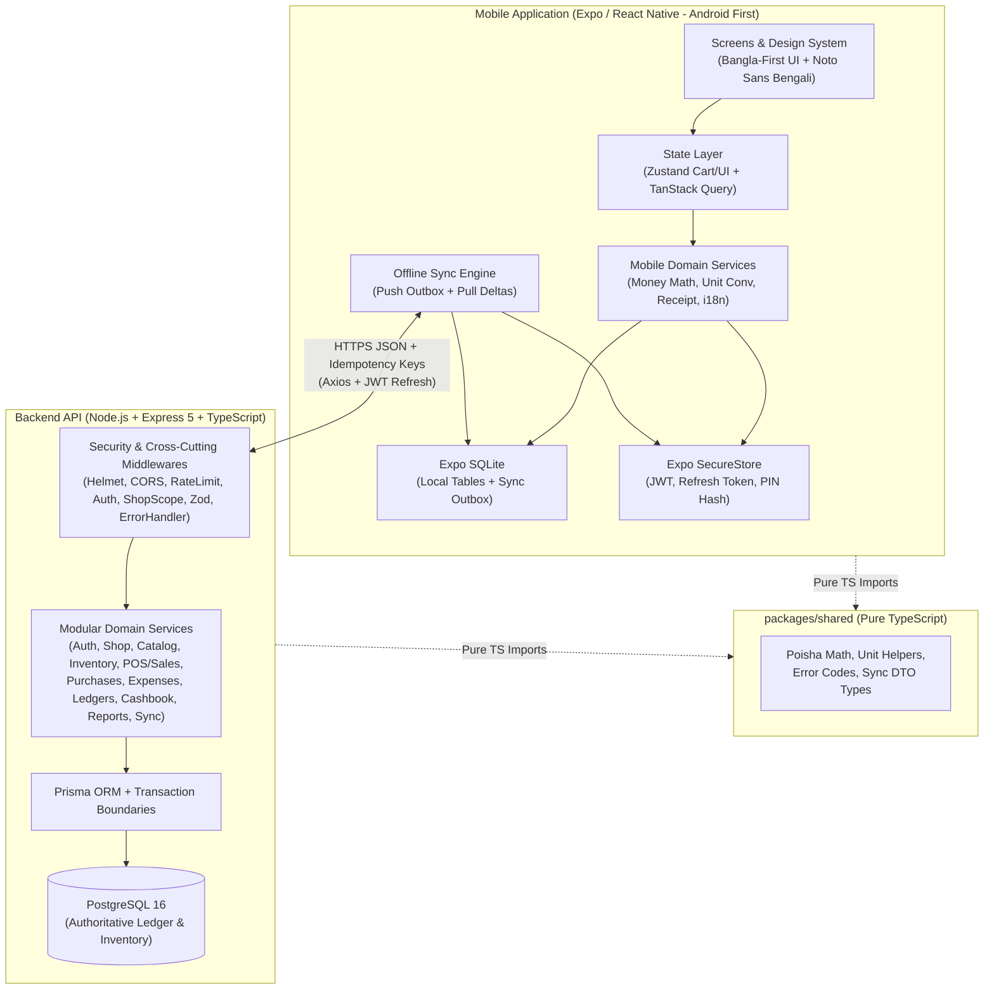

# DokanWala (দোকানওয়ালা) — System Architecture Document

> **Phase:** 0 — Project Discovery and Architecture  
> **Target Domain:** Small Grocery & Convenience Shop Management (Bangladesh)  
> **Primary Language:** Bangla (`bn`, High Priority) with instant English (`en`) switching  
> **Default Currency:** Bangladeshi Taka — BDT (`৳`)  
> **Default Timezone:** `Asia/Dhaka` (`UTC+06:00`)

---

## 1. Repository & Environment Discovery

### 1.1 Current Workspace State
Inspection of `/home/biswass101/Documents/Projects/DokanWala` verified:
- Only `requirements.md` exists in the repository root.
- Git has not been initialized yet (`.git` does not exist). User will review each phase and manage Git/GitHub commits manually.

### 1.2 Local Development Environment
| Component | Detected Version / State | Architectural Implication |
|---|---|---|
| **OS** | Linux | Standard POSIX tooling and Docker support |
| **Node.js** | `v24.20.0` (NVM) | Modern LTS/Current runtime; Prisma 7 (`>=24.0`) and Express 5 compatible |
| **npm** | `11.19.0` | Native npm workspaces supported without third-party package managers |
| **Docker / Compose** | Docker `29.9.0`, Compose `v5.6.0` | Containerized PostgreSQL 16 + test DB ready; note existing unrelated container on host port `5432` -> map DokanWala Postgres to host port **`5433`** (configurable via `.env`) |
| **Android SDK / Java** | Not installed locally | Local verification uses Expo Go / Android device over LAN, Jest + RNTL unit/component tests, and Expo EAS Build for release APKs/AABs |

---

## 2. Confirmed Technology Stack & Compatibility

Package registry compatibility checks performed before dependency selection:

| Layer | Technology | Target Version / Range | Rationale |
|---|---|---|---|
| **Mobile Core** | React Native + Expo + TypeScript (strict) | Expo SDK `~58.0` | Latest stable Expo SDK with first-class `expo-sqlite` & `expo-router` |
| **Navigation** | Expo Router | `~58.0` | File-based typed routing with deep links & tab/stack isolation |
| **Styling** | NativeWind v4 + Tailwind CSS | `nativewind@^4.2`, `tailwindcss@^3.4` | Utility-first styling; NativeWind v4 requires Tailwind CSS v3.4.x |
| **Forms & Validation** | React Hook Form + Zod | `react-hook-form`, `zod@^4` | Zero-re-render forms paired with strict schema validation |
| **State Management** | TanStack Query v5 + Zustand v5 | `@tanstack/react-query`, `zustand` | Server/sync cache separation from ephemeral UI/POS cart state |
| **Local Persistence** | Expo SQLite + Expo SecureStore | `~58.0` | Offline transactional SQLite DB + Android Keystore credential storage |
| **Internationalization** | `i18next` + `react-i18next` + `expo-font` | Latest stable | Bangla (`bn`) first-class UI + bundled `Noto Sans Bengali` font |
| **Backend Core** | Node.js + Express + TypeScript (strict) | `express@^5.3`, `ts` strict | Lightweight modular Express 5 (native async error propagation); **no NestJS** |
| **Database & ORM** | PostgreSQL 16 + Prisma ORM | `postgres:16-alpine`, `prisma@^7.10` (stable, non-RC) | Relational integrity, ACID transactions, native `Decimal` support |
| **Security** | Argon2id (`argon2`), `jsonwebtoken`, `helmet`, `cors`, `express-rate-limit` | `argon2@^0.45`, latest stable | Memory-hard password/PIN hashing, strict middleware security |
| **Financial Math** | `decimal.js` + Integer Poisha | `decimal.js` | Eliminates JavaScript IEEE-754 floating-point errors |
| **Logging & Testing** | `pino`, Jest/Vitest, Supertest, RNTL | Latest stable | Structured JSON logs with secret redaction; full unit/API/UI coverage |

---

## 3. High-Level System Architecture



### Key Architectural Principles
1. **Local-First Read & Write on Mobile:** Every shopkeeper action (POS checkout, expense, customer collection, purchase) reads from and writes to **Expo SQLite** immediately so the shop never pauses when mobile data drops.
2. **Server-Authoritative Financial Ledger:** When online (or during sync), the Express backend recalculates line totals, discounts, COGS, stock balances, and dues inside ACID PostgreSQL transactions. The client is never trusted for final authority.
3. **Bangla-First Domain Modeling:** Product names, categories, units, receipts, exports, and error messages are designed for Bangla natively rather than bolted on as an afterthought.
4. **Strict Separation of Concerns:**
   - **Controllers:** HTTP parsing, status codes, calling services, formatting standard responses. Never embed SQL or financial math in routes/controllers.
   - **Services:** Pure business rules, Prisma transactions, WAC costing, audit logging.
   - **Repositories (where beneficial):** Complex reporting/ledger queries isolated from business orchestration.
   - **Mobile UI vs Domain:** Screens bind to feature hooks; business calculations (cart totals, unit conversions, BDT formatting) live in testable TypeScript modules, never inline inside JSX.

---

## 4. Monorepo & Folder Structure

```text
DokanWala/
├── .editorconfig
├── .gitignore
├── docker-compose.yml              # PostgreSQL 16 (port 5433) + Test Postgres (port 5434)
├── package.json                    # npm workspaces & root scripts (lint, typecheck, test)
├── requirements.md
├── README.md
├── docs/                           # Phase 0 architecture & engineering documentation
│   ├── 01-architecture.md
│   ├── 02-database-design.md
│   ├── 03-api-conventions.md
│   ├── 04-offline-sync-design.md
│   ├── 05-security-architecture.md
│   ├── 06-design-system-and-bangla-ux.md
│   └── 07-roadmap-and-checklist.md
│
├── packages/
│   └── shared/                     # Zero-native-dependency pure TS domain utilities & contracts
│       ├── package.json
│       ├── tsconfig.json
│       └── src/
│           ├── constants/          # Error codes, roles, payment methods, unit definitions
│           ├── money/              # Integer poisha + decimal.js helpers, rounding, BDT formatting
│           ├── units/              # Base unit conversion helpers
│           ├── validation/         # Shared regex/normalizers (Bangla digit normalizer, BD phone)
│           └── types/              # API response envelopes & Sync DTO contracts
│
├── backend/
│   ├── package.json
│   ├── tsconfig.json
│   ├── .env.example
│   ├── prisma/
│   │   ├── schema.prisma
│   │   ├── migrations/
│   │   └── seed.ts                 # Default Bangla/English units, categories, expense categories
│   ├── tests/
│   │   ├── unit/                   # Money math, WAC, P&L, unit conversion tests
│   │   ├── integration/            # Supertest + real PostgreSQL API & transaction rollback tests
│   │   └── helpers/
│   └── src/
│       ├── config/                 # Zod-validated env, logger (Pino), cors, constants
│       ├── database/               # Prisma client singleton, transaction helper, health check
│       ├── middlewares/            # auth, rbac, shopScope, validate, rateLimit, idempotency, errorHandler, requestLogger
│       ├── shared/
│       │   ├── errors/             # AppError hierarchy mapped to bilingual error codes
│       │   ├── utils/              # Timezone (Asia/Dhaka), pagination, cursor helpers
│       │   ├── validators/         # Reusable Zod primitives (UUID, BD phone, poisha, decimal qty)
│       │   └── types/              # Express Request augmentation (auth context)
│       ├── modules/
│       │   ├── auth/               # Register/seed, login, PIN setup/verify, refresh, logout, sessions
│       │   ├── shop/               # Shop profile, receipt config, settings, user management
│       │   ├── categories/         # Product categories CRUD
│       │   ├── units/              # Measurement units & unit conversions
│       │   ├── products/           # Product CRUD, bilingual search, archive, product units
│       │   ├── inventory/          # Balances, stock movements, adjustments, wastage/damage, alerts
│       │   ├── sales/              # POS checkout, returns, cancellations, receipts, sales history
│       │   ├── purchases/          # Supplier purchases, purchase returns, WAC recalculation
│       │   ├── expenses/           # Expense categories, expenses CRUD + edit audit log
│       │   ├── customers/          # Customers, credit dues, collections, customer ledger
│       │   ├── suppliers/          # Suppliers, payables, supplier payments, supplier ledger
│       │   ├── cashbook/           # Opening/closing cash, cash/MFS ledger entries
│       │   ├── reports/            # Daily/weekly/monthly, P&L, inventory valuation, exports (CSV/PDF)
│       │   ├── sync/               # Outbox push processor & monotonic cursor delta pull
│       │   └── backup/             # JSON/CSV shop snapshot export & validated restore
│       ├── app.ts                  # Express app factory (testable without listening)
│       └── server.ts               # Graceful startup & shutdown
│
└── mobile/
    ├── package.json
    ├── tsconfig.json
    ├── app.json
    ├── tailwind.config.js
    ├── metro.config.js             # Monorepo-aware Metro config
    ├── assets/
    │   └── fonts/                  # NotoSansBengali-*.ttf, Inter-*.ttf
    ├── __tests__/                  # Component, hook, cart, offline & sync tests
    └── src/
        ├── app/                    # Expo Router routes only (thin route shells)
        │   ├── _layout.tsx         # Providers (QueryClient, SQLite init, i18n, Fonts, Theme)
        │   ├── (auth)/             # login.tsx, pin-unlock.tsx, shop-setup.tsx
        │   ├── (tabs)/             # index (Home), sales (POS), products, reports, more
        │   └── ...                 # Focused stack screens (sale/[id], product/form, purchase/new, etc.)
        ├── components/             # Reusable Design System primitives
        │   ├── ui/                 # Button, Card, Input, NumericInput (Bangla-aware), Badge, BottomSheet, Modal, Toast
        │   ├── feedback/           # LoadingView, EmptyState, ErrorState, SyncStatusBanner, ConfirmDialog
        │   └── layout/             # ScreenContainer (SafeArea + KeyboardAvoiding), Header
        ├── features/               # Cohesive feature modules
        │   ├── auth/
        │   ├── dashboard/
        │   ├── sales/
        │   ├── products/
        │   ├── inventory/
        │   ├── purchases/
        │   ├── expenses/
        │   ├── customers/
        │   ├── suppliers/
        │   ├── cashbook/
        │   ├── reports/
        │   ├── sync/
        │   └── settings/
        ├── database/               # Expo SQLite connection, migrations, local repositories, outbox queue
        ├── hooks/                  # useNetworkStatus, useSyncTrigger, useAppTranslation, useFormattedMoney
        ├── i18n/                   # i18next config, bn/ & en/ JSON namespaces, Bangla digit & date formatters
        ├── services/               # Axios client (JWT interceptor + refresh queue), API wrappers, receipt/PDF/CSV exporters
        ├── store/                  # Zustand stores (POS cart, active filters, UI preferences, lock state)
        ├── theme/                  # Design tokens (colors, typography, spacing, shadows)
        ├── types/                  # Mobile-specific UI & navigation types
        └── utils/                  # Bangla numeral normalizer, validation schemas, safe helpers
```

---

## 5. Financial Calculation & Inventory Costing Architecture

### 5.1 Decimal-Safe Money & Quantity Rules
1. **No raw floating-point arithmetic on money:** JavaScript `number` arithmetic (`0.1 + 0.2`) is banned for financial calculations.
2. **Monetary Storage (`Poisha`):** All settled currency amounts (`totalPoisha`, `paidPoisha`, `duePoisha`, `discountPoisha`, `expenseAmountPoisha`, `cogsPoisha`, `unitPricePoisha`) are stored as integer **poisha** (`1 BDT = 100 poisha`) using PostgreSQL `BIGINT` and SQLite `INTEGER`.
   - `Number.MAX_SAFE_INTEGER` supports up to `৳ 90,071,992,547,409` (~90 trillion Taka), far exceeding any shop's lifetime volume while remaining 100% exact for SQL `SUM()`.
3. **Fractional Quantities & Sub-Poisha Unit Costs:**
   - Products like *Supari* can be purchased per `kg` (e.g., `৳ 855/kg`) and sold per `gram` (`৳ 0.855/g = 85.5 poisha/g`) in arbitrary weights (`250g`, `0.25kg`, `1.5` bundle).
   - Quantities (`qtyBase`, `qtyDisplay`) use `DECIMAL(15, 4)` in PostgreSQL and `TEXT` decimal strings in SQLite, evaluated via **`decimal.js`**.
   - Weighted-average unit cost (`avgCostPerBaseBdt`) uses `DECIMAL(18, 6)` (6 decimal places in BDT) in PostgreSQL and `TEXT` in SQLite.
   - Line-item totals and COGS are computed in `decimal.js` and rounded **HALF_UP** to whole **poisha** (`integer`) at the line-item boundary.

### 5.2 Inventory Costing Method: Moving Weighted-Average Cost (WAC)
Chosen because small Bangladeshi grocery shops frequently restock *Pan*, *Supari*, and packaged goods at fluctuating daily market prices without barcode-level lot tracking (FIFO batches add friction a shopkeeper will not type).

**WAC Equations:**
- **On Purchase (`qtyInBase > 0`, `totalPurchaseCostPoisha`):**
  $$\text{newQtyBase} = \text{oldQtyBase} + \text{qtyInBase}$$
  $$\text{newAvgCostBdt} = \frac{(\text{oldQtyBase} \times \text{oldAvgCostBdt}) + (\text{totalPurchaseCostPoisha} / 100)}{\text{newQtyBase}}$$
  *(If `oldQtyBase <= 0`, `newAvgCostBdt = (totalPurchaseCostPoisha / 100) / qtyInBase`.)*
- **On Sale (`qtySoldBase > 0`):**
  - `unitCostAtSaleBdt` = snapshot of current `avgCostPerBaseBdt` (never overwritten later).
  - `lineCogsPoisha` = `roundHalfUp(qtySoldBase * unitCostAtSaleBdt * 100)`.
  - `avgCostPerBaseBdt` remains unchanged on sale; `qtyBase` decreases by `qtySoldBase`.
- **On Sale Return (`qtyReturnedBase > 0`):**
  - Restores `qtyReturnedBase` to `InventoryBalance` using the original `SaleItem.unitCostAtSaleBdt` (re-averaging into WAC) and reverses proportional COGS.
- **On Wastage / Damage / Expiry (`qtyLostBase > 0`):**
  - Deducts `qtyLostBase` from `InventoryBalance`.
  - Records `lossPoisha = roundHalfUp(qtyLostBase * avgCostPerBaseBdt * 100)` on `StockAdjustment` so spoiled fresh *Pan* reduces Net Profit transparently.

### 5.3 Profit & Loss Accounting Rules
- **Revenue Recognition:** Full `Net Sale` (`subtotal - discount`) is recognized on the sale date (`soldAt`), whether paid in cash, bKash/Nagad, partially, or on credit (`বাকি`).
- **Due Collections:** `CustomerPayment` reduces `Customer.duePoisha` and adds cash/MFS inflow to `CashbookEntry`. It **never** creates revenue or a second sale.
- **Formulas (evaluated over `Asia/Dhaka` date range):**
  - `Net Sales` = `Gross Sales` − `Sale Discounts` − `Sale Returns (net value)`
  - `Net COGS` = `Sold COGS` − `Returned COGS`
  - `Gross Profit` = `Net Sales` − `Net COGS`
  - `Net Profit` = `Gross Profit` − `Operating Expenses` − `Wastage/Damage Losses`
