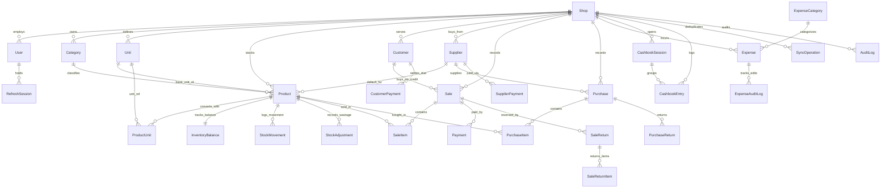

# DokanWala (দোকানওয়ালা) — Database Architecture & Entity-Relationship Design

> **Engine:** PostgreSQL 16 (Server Authoritative via Prisma ORM) + Expo SQLite (Local-First Mirror & Outbox)  
> **Primary Keys:** UUID v4 across all offline-creatable entities (enables conflict-free offline creation)

---

## 1. Pre-Schema Business Relationship Analysis

Before implementing Prisma models in Phase 1/2, the domain relationships are structured around one central tenant (`Shop`) with strict multi-tenant isolation (`shopId` on every business record):

1. **Shop & Identity (`Shop`, `User`, `RefreshSession`):**
   - A `Shop` owns settings (Bangla/English shop name, address, logo URL, default currency `BDT`, timezone `Asia/Dhaka`, default language `bn`, receipt header/footer, stock policy).
   - `User` belongs to a `Shop` with role `OWNER` or `EMPLOYEE`. Passwords and quick PINs are hashed independently with Argon2id. `RefreshSession` tracks per-device revocable refresh tokens.
2. **Catalog & Flexible Measurement Units (`Category`, `Unit`, `Product`, `ProductUnit`):**
   - `Category` has bilingual fields (`nameBn`, `nameEn`).
   - `Unit` defines shop/global measurement units (`piece/টি`, `gram/গ্রাম`, `kg/কেজি`, `bundle/বিড়া`, `packet/প্যাকেট`, `jar/কৌটা`, `liter/লিটার`, `ml/মিলি`).
   - `Product` specifies one canonical **`baseUnitId`** (the smallest tracked inventory unit for that product), plus `defaultSaleUnitId`, `defaultPurchaseUnitId`, `baseSellingPricePoisha`, `lowStockThresholdBase`, optional `barcode`, `defaultSupplierId`, and `isActive`.
   - `ProductUnit` enables per-product flexible unit conversion (`conversionFactorToBase` e.g., for *Pan*: `1 বিড়া = 20 or 64 টি`, for *Supari*: `1 কেজি = 1000 গ্রাম`, `1 পোয়া = 250 গ্রাম`) and optional unit-specific bundle selling price override (`sellingPricePoisha`).
3. **Inventory & Movements (`InventoryBalance`, `StockMovement`, `StockAdjustment`):**
   - Separating `InventoryBalance` (1:1 with `Product`) from `Product` avoids write contention when editing catalog metadata while POS checkouts/purchases update stock atomically.
   - Every change to `InventoryBalance` (sale, sale return, purchase, purchase return, manual count adjustment, damage, expiry, wastage) MUST append an immutable `StockMovement` row recording `deltaQtyBase`, `balanceAfterBase`, `unitCostBdt`, `movementType`, and `referenceId`.
4. **Sales, Returns & Payments (`Sale`, `SaleItem`, `Payment`, `SaleReturn`, `SaleReturnItem`):**
   - Ordinary cash sales do NOT require a `Customer` (`customerId` is nullable). Credit/partial sales (`বাকি`) MUST link to a `Customer`.
   - `SaleItem` permanently snapshots `unitId`, `qtyDisplay`, `conversionFactorToBase`, `qtyBase`, `unitSellingPricePoisha`, `unitCostAtSaleBdt`, `lineSubtotalPoisha`, and `lineCogsPoisha`.
   - `Payment` supports split/multiple methods on one sale (e.g., `৳ 300 Cash + ৳ 200 bKash` on a `৳ 500` sale).
   - `SaleReturn` & `SaleReturnItem` reverse stock, COGS, and either refund cash/MFS or credit the customer's due balance without deleting the original `Sale`.
5. **Purchases & Suppliers (`Supplier`, `Purchase`, `PurchaseItem`, `PurchaseReturn`, `SupplierPayment`):**
   - Purchases restock multiple products, recalculate Moving Weighted-Average Cost (WAC) on `InventoryBalance`, track `paidPoisha` vs `duePoisha`, and increase `Supplier.payablePoisha`.
   - `SupplierPayment` reduces `Supplier.payablePoisha` and writes a `CashbookEntry` outflow.
6. **Customers & Credit Collections (`Customer`, `CustomerPayment`):**
   - `Customer` maintains denormalized fast-read aggregates (`totalPurchasedPoisha`, `totalPaidPoisha`, `duePoisha`) kept strictly consistent inside DB transactions alongside immutable `Sale` and `CustomerPayment` ledger rows.
7. **Expenses & Cashbook (`ExpenseCategory`, `Expense`, `ExpenseAuditLog`, `CashbookSession`, `CashbookEntry`):**
   - `Expense` edits are tracked in `ExpenseAuditLog` (capturing `beforeJson`, `afterJson`, `editedById`, `reason`) to prevent silent cash tampering.
   - `CashbookSession` records daily `openingCashPoisha` and `closingCashPoisha` (counted vs expected) per shop day (`Asia/Dhaka`).
   - `CashbookEntry` is an immutable chronological cash/MFS flow ledger (`IN` / `OUT`) linked to sales, customer collections, expenses, supplier payments, and owner capital deposits/drawings.
8. **Synchronization & Audit (`SyncOperation`, `AuditLog`, `SyncSeq`):**
   - `SyncOperation` enforces idempotency (`(shopId, idempotencyKey)`) and stores request/response summaries for safe offline retries.
   - `AuditLog` tracks sensitive security & administrative changes (PIN reset, role change, price change, wastage, sale cancellation, backup restore).

---

## 2. Entity-Relationship Diagram (ERD)

---

## 3. Keys, Unique Constraints & Index Strategy

### 3.1 Primary & Foreign Key Policy
- **Primary Keys:** `UUID` (`@db.Uuid`, client-generated UUID v4 for offline-capable records, server UUID v4 otherwise).
- **Foreign Keys:**
  - `ON DELETE RESTRICT` on all financial and inventory references (`SaleItem -> Product`, `Sale -> Customer`, `Purchase -> Supplier`, `Payment -> Sale`, `StockMovement -> Product`). **Financial history must never be cascade-deleted.**
  - `ON DELETE CASCADE` only for internal session/token rows (`RefreshSession -> User`) or strictly owned detail drafts if ever discarded before finalization.

### 3.2 Unique Constraints
| Table | Unique Constraint | Purpose |
|---|---|---|
| `User` | `(phone)` (normalized `+8801...`) | Single login identifier per user |
| `Category` | `(shopId, nameBn)` where `deletedAt IS NULL` | Prevent duplicate category names in a shop |
| `Unit` | `(shopId, code)` | Unique unit codes (`PIECE`, `KG`, `GRAM`, `BIRA`, etc.) |
| `Product` | `(shopId, barcode)` (partial unique where `barcode IS NOT NULL AND deletedAt IS NULL`) | Fast barcode scan lookup without collisions |
| `ProductUnit` | `(productId, unitId)` | One conversion rule per unit per product |
| `InventoryBalance` | `(productId)` | Strictly one live balance row per product |
| `Sale` | `(shopId, receiptNumber)` | Sequential human-readable receipt number (`INV-20261112-0001`) |
| `Purchase` | `(shopId, purchaseNumber)` | Sequential purchase reference |
| `CashbookSession` | `(shopId, businessDate)` | One opening/closing register per shop calendar day (`YYYY-MM-DD` `Asia/Dhaka`) |
| `SyncOperation` | `(shopId, idempotencyKey)` | Idempotent offline retry protection |

### 3.3 Critical Database Indexes
- **Tenant + Delta Sync (`syncSeq`):** Every syncable entity carries a server-assigned monotonic `syncSeq BIGINT` (`BIGSERIAL` / sequence) indexed as `(shopId, syncSeq)` so pull sync is $O(\log N)$ with zero clock-skew vulnerability.
- **POS & Catalog Search:** `(shopId, isActive, deletedAt)`, `(shopId, categoryId)`, `(shopId, barcode)`, plus PostgreSQL `GIN` trigram index (`pg_trgm`) on `nameBn` and `nameEn` for fast Bangla/English substring matching.
- **Financial & Date-Range Reports:**
  - `Sale(shopId, soldAt DESC, status)`
  - `SaleItem(saleId)` and `SaleItem(productId, createdAt)`
  - `Purchase(shopId, purchasedAt DESC)`
  - `Expense(shopId, incurredAt DESC, categoryId)`
  - `CashbookEntry(shopId, occurredAt DESC, paymentMethod)`
  - `StockMovement(shopId, productId, createdAt DESC)`
- **Ledgers & Low-Stock Alerts:**
  - `Customer(shopId, duePoisha)` (fast "Customers with Dues" list)
  - `Supplier(shopId, payablePoisha)`
  - `CustomerPayment(shopId, customerId, paidAt DESC)`
  - `SupplierPayment(shopId, supplierId, paidAt DESC)`

---

## 4. Soft Deletion vs Append-Only Financial Records

| Entity Group | Deletion Strategy | Behavior |
|---|---|---|
| **Catalog & Directory** (`Product`, `Category`, `Customer`, `Supplier`, `ExpenseCategory`) | **Soft Delete / Archive** (`isActive = false`, `deletedAt = now()`) | Hidden from active POS pickers unless queried for historical reports; existing `SaleItem`/`PurchaseItem` FKs remain 100% intact. Customers/Suppliers with non-zero dues cannot be archived without explicit confirmation. |
| **Financial & Inventory Events** (`Sale`, `SaleItem`, `Payment`, `SaleReturn`, `Purchase`, `StockMovement`, `StockAdjustment`, `CustomerPayment`, `SupplierPayment`, `CashbookEntry`) | **Immutable Append-Only** (NEVER deleted or hard-edited) | Corrections happen via explicit compensating transactions (`SaleReturn`, `SaleCancellation`, `PurchaseReturn`, `StockAdjustment`, `CashbookReversal`) preserving full auditability. `Expense` supports audited edits via `ExpenseAuditLog` + delta `CashbookEntry` adjustment. |

---

## 5. Transaction Boundaries (ACID Guarantees)

Every multi-table financial or inventory operation runs inside a single **`prisma.$transaction`** (and a single SQLite `withTransactionAsync` locally) with row-level locking (`SELECT ... FOR UPDATE` on `InventoryBalance`, `Customer`, `Supplier` during server writes) to prevent race conditions:

1. **Create Sale (`POS Checkout`):**
   - Verify/insert `SyncOperation` (`idempotencyKey`) -> lock `InventoryBalance` rows -> validate stock -> compute line subtotals, discounts, WAC COGS -> insert `Sale` + `SaleItem[]` + `Payment[]` -> decrement `InventoryBalance.qtyBase` -> insert `StockMovement[]` (`SALE_OUT`) -> if `duePoisha > 0`, lock `Customer` and increment `totalPurchasedPoisha`, `totalPaidPoisha`, `duePoisha` -> for each cash/MFS `Payment`, insert `CashbookEntry` (`SALE_IN`).
2. **Create Sale Return / Cancellation:**
   - Lock `Sale` + `SaleReturn` check (prevent returning more than sold quantity!) -> insert `SaleReturn` + `SaleReturnItem[]` -> lock `InventoryBalance` -> restore `qtyBase` & recalculate WAC -> insert `StockMovement` (`RETURN_IN`) -> update `Sale.status` (`PARTIALLY_RETURNED` / `RETURNED` / `CANCELLED`) -> if cash/MFS refunded, insert `CashbookEntry` (`REFUND_OUT`); if credited against `duePoisha`, decrement `Customer.duePoisha`.
3. **Create Purchase:**
   - Insert `Purchase` + `PurchaseItem[]` -> lock `InventoryBalance` -> compute new Moving WAC `avgCostPerBaseBdt` and increment `qtyBase` -> insert `StockMovement[]` (`PURCHASE_IN`) -> if `duePoisha > 0` or `supplierId` linked, update `Supplier.totalPurchasedPoisha`, `totalPaidPoisha`, `payablePoisha` -> if `paidPoisha > 0`, insert `CashbookEntry` (`PURCHASE_OUT`).
4. **Collect Customer Due (`CustomerPayment`):**
   - Lock `Customer` -> validate `amountPoisha <= duePoisha` (or handle advance deposit explicitly if allowed) -> insert `CustomerPayment` -> decrement `Customer.duePoisha` & increment `totalPaidPoisha` -> insert `CashbookEntry` (`DUE_COLLECTION_IN`). *(Does NOT touch `Sale` revenue!)*
5. **Pay Supplier Due (`SupplierPayment`):**
   - Lock `Supplier` -> insert `SupplierPayment` -> decrement `Supplier.payablePoisha` & increment `totalPaidPoisha` -> insert `CashbookEntry` (`SUPPLIER_PAYMENT_OUT`).
6. **Record Wastage / Damage / Expiry / Count Adjustment (`StockAdjustment`):**
   - Lock `InventoryBalance` -> validate quantity -> compute `lossPoisha = roundHalfUp(qtyBase * avgCostPerBaseBdt * 100)` -> update `InventoryBalance.qtyBase` -> insert `StockAdjustment` -> insert `StockMovement` (`WASTAGE_OUT` / `DAMAGE_OUT` / `EXPIRED_OUT` / `COUNT_ADJUST`) -> insert `AuditLog`.
7. **Create / Edit Expense:**
   - Create: insert `Expense` + insert `CashbookEntry` (`EXPENSE_OUT`).
   - Edit: insert `ExpenseAuditLog` (before/after snapshot) + update `Expense` + insert compensating `CashbookEntry` delta if amount/method changed.

---

## 6. Inventory Quantities, Unit Conversions & Historical Accuracy

### 6.1 Inventory Storage Mechanics
- **Rule:** Every product has **one immutable `baseUnitId`** after its first stock movement (changing base unit mid-history would corrupt historical quantities; if needed, a new product variant is created or an explicit conversion migration tool is used).
- `InventoryBalance` stores:
  - `qtyBase: Decimal(15, 4)` (e.g., `5000.0000` grams, `120.0000` pieces, `15.5000` bundles)
  - `avgCostPerBaseBdt: Decimal(18, 6)` (e.g., `0.855000` BDT/gram)
  - `version: Int` (incremented on every update for optimistic locking & sync visibility)
- **Inventory Valuation:** Calculated directly at any time as $\sum (\text{qtyBase} \times \text{avgCostPerBaseBdt})$.

### 6.2 Concrete Bangladeshi Unit Conversion Examples
| Product | Base Unit | Configured `ProductUnit` Rules | Purchase Flow | Sale Flow |
|---|---|---|---|---|
| **রাজশাহীর পান (Pan)** | `piece (টি)` | `টি` (`factor = 1`, `৳ 2`), `বিড়া` (`factor = 20`, `৳ 35`) | Buy `10 বিড়া` @ `৳ 25/বিড়া` (`৳ 250`) -> `+200 টি` @ `৳ 1.25/টি` | Sell `1 বিড়া` (`20 টি`) @ `৳ 35` + `5 টি` @ `৳ 2` = `৳ 45`; deducts `25 টি`, COGS = `25 * 1.25 = ৳ 31.25` |
| **সুপারি (Supari)** | `gram (গ্রাম)` | `গ্রাম` (`factor = 1`), `পোয়া` (`factor = 250`), `কেজি` (`factor = 1000`, `৳ 1100`) | Buy `5 কেজি` @ `৳ 855/কেজি` (`৳ 4,275`) -> `+5000 গ্রাম` @ `৳ 0.855/গ্রাম` | Sell `250 গ্রাম` (`1 পোয়া`) -> deducts `250 গ্রাম`; revenue `৳ 275.00`, COGS `৳ 213.75` |
| **জর্দা (Jorda)** | `packet (প্যাকেট)` | `প্যাকেট` (`factor = 1`, `৳ 25`), `কৌটা/বক্স` (`factor = 12`, `৳ 280`) | Buy `2 কৌটা` @ `৳ 240/কৌটা` -> `+24 প্যাকেট` @ `৳ 20/প্যাকেট` | Sell `3 প্যাকেট` -> deducts `3 প্যাকেট`, COGS `৳ 60` |

### 6.3 Historical Accuracy Guarantee
Because `SaleItem` permanently saves `unitSellingPricePoisha`, `unitCostAtSaleBdt`, `lineSubtotalPoisha`, and `lineCogsPoisha`, and `SaleReturnItem` references the exact `SaleItem`, historical P&L reports for any past day/month remain **100% invariant** regardless of future purchase price spikes or catalog price edits.

---

## 7. Local Expo SQLite Schema Parity
Mobile SQLite mirrors all shop-scoped operational tables (`categories`, `units`, `products`, `product_units`, `inventory_balances`, `stock_movements`, `stock_adjustments`, `customers`, `customer_payments`, `suppliers`, `supplier_payments`, `sales`, `sale_items`, `payments`, `sale_returns`, `purchases`, `purchase_items`, `expense_categories`, `expenses`, `cashbook_sessions`, `cashbook_entries`) with:
- Exact same UUID primary keys.
- `INTEGER` columns for all `*_poisha` monetary fields.
- `TEXT` columns for decimal quantities (`qty_base`) and `avg_cost_per_base_bdt` evaluated via `decimal.js`.
- Sync metadata columns on mutable/created tables: `sync_status` (`SYNCED` | `PENDING` | `CONFLICT`), `server_version` (`INTEGER`), `sync_seq` (`INTEGER`), `updated_at_ms` (`INTEGER`).
- Dedicated local infrastructure tables:
  - `sync_outbox` (ordered mutation queue with `idempotency_key`, retry state, dependency pointer)
  - `sync_cursor` (stores `last_pull_sync_seq`, `last_synced_at`)
  - `app_preferences` (language `bn`/`en`, digit style, active shop metadata)
