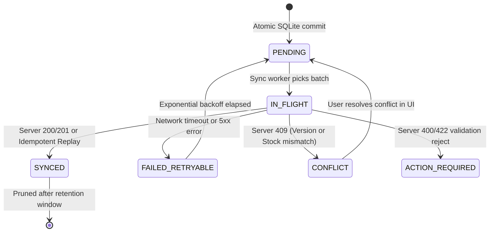
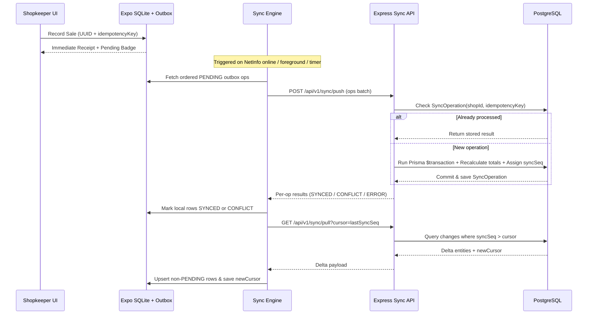

# DokanWala (দোকানওয়ালা) — Offline-First & Synchronization Design

> **Core Requirement:** A shopkeeper in Bangladesh with unstable 3G/4G or zero internet must run POS sales, customer credit collections, expenses, purchases, and stock checks without interruption—and never lose or duplicate financial data when connectivity returns.

---

## 1. Local-First Guarantees

1. **Zero Blocking Network Calls on POS/Core Flows:** Every create/update action reads and writes **Expo SQLite** inside a local ACID transaction first.
2. **Immediate Local Financial Consistency:** When a sale is recorded offline:
   - `sales`, `sale_items`, `payments`, `stock_movements`, `cashbook_entries` are inserted locally.
   - `inventory_balances.qty_base` is decremented locally.
   - If credit (`বাকি`), `customers.due_poisha` is incremented locally.
   - A `sync_outbox` operation is appended in the **exact same SQLite transaction**.
3. **Crash Resilience:** Because data + outbox entry commit atomically, killing the app or losing phone battery mid-day never leaves orphaned sales or missing outbox items.

---

## 2. Outbox Queue State Machine

### Crash Recovery on Startup
If the app crashed while an outbox item was `IN_FLIGHT`, the startup bootstrap immediately resets `IN_FLIGHT -> PENDING` and re-submits using the **exact same `idempotencyKey`**. The server detects the key in `SyncOperation` and safely returns the original result without duplicating the sale or payment.

---

## 3. Synchronization Protocol (Push-Then-Pull)

### 3.1 Causal Dependency Ordering
Operations created offline can reference newly created offline entities (e.g., `CREATE_CUSTOMER` UUID `c1` -> `CREATE_SALE` referencing `c1` -> `CREATE_CUSTOMER_PAYMENT` referencing `c1`).
- Every outbox row gets a monotonically increasing local `sequence_no INTEGER PRIMARY KEY AUTOINCREMENT` and an optional `depends_on_entity_id`.
- `push` processes operations in strict `sequence_no ASC` order.
- If an operation fails with `CONFLICT` or `ACTION_REQUIRED`, operations depending on that failed `entityId` are paused (`BLOCKED_BY_DEPENDENCY`) while independent operations (e.g., unrelated cash sales or expenses) continue syncing smoothly!

### 3.2 Monotonic Server Pull Cursor (`syncSeq`)
- **Never use client device timestamps for sync cursors** (low-cost Android phones frequently have wrong clock times).
- PostgreSQL assigns a monotonically increasing `syncSeq` (`BIGINT`) via a PostgreSQL sequence on every synced write.
- `GET /sync/pull?cursor=1050` returns records with `syncSeq > 1050` ordered by `syncSeq ASC`, up to `limit=200` with `hasMore`.
- **Rule:** Pull sync **never overwrites** a local SQLite row whose `sync_status` is `PENDING` or `CONFLICT`.

---

## 4. Conflict Detection & Resolution Rules

| Scenario | Detection Mechanism | Behavior (Never Silently Overwrite!) |
|---|---|---|
| **Duplicate Request / Retry** | `(shopId, idempotencyKey)` exists in `SyncOperation` | Server returns `200` with original receipt/entity; mobile marks `SYNCED`. |
| **Product / Customer Edited on Two Devices** | `op.baseVersion !== server.version` | Server returns `409 VERSION_CONFLICT` with both `serverSnapshot` and `clientPayload`. Mobile marks `CONFLICT` and prompts shopkeeper to choose **Keep Mine** or **Use Server** (with clear Bangla side-by-side comparison). |
| **Offline Sale Price Differs from Newer Server Price** | `item.unitSellingPricePoisha !== currentServerPrice` | **Real POS Sale Preservation:** Because the customer already paid the agreed price offline, server honors the sale price *within a configurable/logged audit flag*, creates an `AuditLog` (`OFFLINE_PRICE_VARIANCE`), and notifies the Owner rather than rejecting a completed cash sale! |
| **Insufficient Stock After Offline Multi-Device Sales** | `requestedBase > serverInventory.qtyBase` | Configurable per shop policy (confirmed in Phase 0): either marks `CONFLICT` (`INSUFFICIENT_STOCK`) for Owner resolution OR allows negative stock reconciliation with an explicit `LOW_STOCK_DISCREPANCY` alert to Owner so real revenue is never lost. |
| **Sale Referencing Archived Product** | `product.deletedAt !== null` | Server allows historical sale completion if product exists (soft-deleted, never hard-deleted!) and alerts Owner, or flags conflict if product never synced. |

---

## 5. Retry Policy & User Feedback

### 5.1 Retry Backoff Schedule
Transient errors (network drop, DNS failure, HTTP `429`, `502`, `503`, `504`):
- Retry delays: `2s -> 5s -> 15s -> 60s -> 5m` (capped at `5m`, with +/-20% jitter).
- Trigger immediate retry reset when OS fires `NetInfo` transition from `offline -> online`.

### 5.2 Clear Shopkeeper Sync Status Indicators (Bangla-First)
Always visible as a compact, non-intrusive status pill in the top header & More/Settings sync screen:
- **All Synced (Online):** Green dot — `সব তথ্য সিঙ্ক করা আছে` (Synced)
- **Pending Offline Items:** Amber pill — `অফলাইন • ৩টি লেনদেন বাকি` (Offline • 3 pending)
- **Syncing Now:** Animated subtle indicator — `সিঙ্ক হচ্ছে...` (Syncing...)
- **Conflict / Needs Attention:** Red tap-able banner — `১টি তথ্যে অমিল আছে — ঠিক করুন` (1 conflict — resolve)
